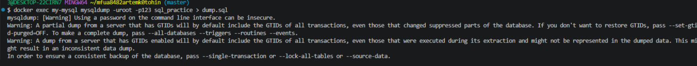

#  README для проекта "MySQL в Docker"

Вот готовый `README.md`, который можно сразу положить в твой репозиторий. Он структурирован, содержит навигацию и покрывает все ключевые моменты из твоей работы.

---

```markdown
#  Интерактивная работа с MySQL в Docker

Практическое руководство по работе с базой данных MySQL в изолированном окружении Docker. Включает настройку контейнера, основные SQL-операции, JOIN-запросы, агрегацию и создание дампов.

---

## 📋 Содержание

- [Требования](#-требования)
- [Быстрый старт](#-быстрый-старт)
- [Структура проекта](#-структура-проекта)
- [Шаг 1. Запуск контейнера](#-шаг-1-запуск-контейнера)
- [Шаг 2. Подключение к MySQL](#-шаг-2-подключение-к-mysql)
- [Шаг 3. Основные SQL-операции](#-шаг-3-основные-sql-операции)
- [Шаг 4. JOIN, GROUP BY, подзапросы](#-шаг-4-join-group-by-подзапросы)
- [Шаг 5. Дамп базы данных](#-шаг-5-дамп-базы-данных)
- [Полезные команды](#-полезные-команды)
- [Решение проблем](#-решение-проблем)
- [Дальнейшее изучение](#-дальнейшее-изучение)

---

## ⚙️ Требования

- Установленный **Docker** ([скачать](https://www.docker.com/products/docker-desktop/))
- Терминал: **Git Bash** (Windows), **Terminal** (macOS/Linux)
- Базовое понимание SQL

---

##  Быстрый старт

```bash
# 1. Клонировать репозиторий
git clone <url-репозитория>
cd <папка-проекта>

# 2. Запустить контейнер MySQL
docker run --name my-mysql \
  -e MYSQL_ROOT_PASSWORD=123 \
  -e LANG=C.UTF-8 \
  -v mysql_data:/var/lib/mysql \
  -v $(pwd)/my.cnf:/etc/mysql/conf.d/my.cnf \
  -d mysql:latest

# 3. Подключиться к MySQL
docker exec -it my-mysql mysql --default-character-set=utf8mb4 -uroot -p
# Пароль: 123
```

---

## 📁 Структура проекта

```
.
├── my.cnf          # Конфигурация MySQL (кодировка utf8mb4)
├── dump.sql        # Резервная копия БД (создаётся вручную)
└── README.md       # Этот файл
```

---

## 🐳 Шаг 1. Запуск контейнера

Создаём файл `my.cnf` для корректной работы с кириллицей:

```ini
[mysqld]
character-set-server = utf8mb4
collation-server = utf8mb4_unicode_ci

[client]
default-character-set = utf8mb4

[mysql]
default-character-set = utf8mb4
```

Запуск контейнера:

```bash
docker run --name my-mysql \
  -e MYSQL_ROOT_PASSWORD=123 \
  -e LANG=C.UTF-8 \
  -v mysql_data:/var/lib/mysql \
  -v $(pwd)/my.cnf:/etc/mysql/conf.d/my.cnf \
  -d mysql:latest
```

Проверка:

```bash
docker ps
```

---

##  Шаг 2. Подключение к MySQL

```bash
docker exec -it my-mysql mysql --default-character-set=utf8mb4 -uroot -p
```

> ⚠️ **Важно:** команды `docker exec` выполняются в **терминале**, а не внутри `mysql>`.

---

## 🗄️ Шаг 3. Основные SQL-операции

### Создание БД и таблиц

```sql
CREATE DATABASE sql_practice CHARACTER SET utf8mb4 COLLATE utf8mb4_unicode_ci;
USE sql_practice;

CREATE TABLE customers (
    id INT AUTO_INCREMENT PRIMARY KEY,
    name VARCHAR(100) NOT NULL,
    email VARCHAR(100) NOT NULL UNIQUE,
    city VARCHAR(100),
    created_at TIMESTAMP DEFAULT CURRENT_TIMESTAMP
);

CREATE TABLE orders (
    id INT AUTO_INCREMENT PRIMARY KEY,
    customer_id INT NOT NULL,
    order_date DATE NOT NULL,
    amount DECIMAL(10, 2) NOT NULL,
    status VARCHAR(20) DEFAULT 'new',
    FOREIGN KEY (customer_id) REFERENCES customers(id)
);
```

### CRUD-операции

| Операция | Команда |
|----------|---------|
| **Create** | `INSERT INTO customers (name, email, city) VALUES ('Иван', 'ivan@mail.ru', 'Москва');` |
| **Read** | `SELECT * FROM customers WHERE city = 'Москва';` |
| **Update** | `UPDATE customers SET city = 'Казань' WHERE id = 1;` |
| **Delete** | `DELETE FROM customers WHERE id = 1;` |

---

## 🔗 Шаг 4. JOIN, GROUP BY, подзапросы

### INNER JOIN — только совпадающие строки

```sql
SELECT c.name, o.order_date, o.amount
FROM customers c
JOIN orders o ON c.id = o.customer_id;
```

### LEFT JOIN — все клиенты, даже без заказов

```sql
SELECT c.name, o.amount
FROM customers c
LEFT JOIN orders o ON c.id = o.customer_id;
```

### Агрегация с GROUP BY

```sql
SELECT c.name, COUNT(o.id) AS order_count, SUM(o.amount) AS total
FROM customers c
LEFT JOIN orders o ON c.id = o.customer_id
GROUP BY c.id, c.name
ORDER BY total DESC;
```

### Подзапрос

```sql
SELECT name FROM customers
WHERE id IN (SELECT customer_id FROM orders WHERE amount > 1000);
```

---

## 💾 Шаг 5. Дамп базы данных

Выйти из MySQL (`\q`) и выполнить в терминале:

```bash
docker exec my-mysql mysqldump -uroot -p123 sql_practice > dump.sql
```

Восстановление из дампа:

```bash
docker exec -i my-mysql mysql -uroot -p123 sql_practice < dump.sql
```

---

## 🧰 Полезные команды

| Команда | Описание |
|---------|----------|
| `docker ps` | Список запущенных контейнеров |
| `docker ps -a` | Все контейнеры (включая остановленные) |
| `docker stop my-mysql` | Остановить контейнер |
| `docker start my-mysql` | Запустить контейнер |
| `docker rm -v my-mysql` | Удалить контейнер и данные |
| `SHOW DATABASES;` | Список баз данных |
| `SHOW TABLES;` | Список таблиц |
| `DESCRIBE таблица;` | Структура таблицы |
| `\q` | Выйти из MySQL |

---

## 🛠️ Решение проблем

### Ошибка `ls: cannot access '/var/lib/mysql/sql_practice'`
База данных ещё не создана. Подключитесь к MySQL и выполните `CREATE DATABASE sql_practice;`.

### Ошибка `ERROR 1064 (42000): You have an error in your SQL syntax`
Проверьте:
- Точку с запятой `;` в конце запроса
- Правильное написание команд (`SHOW DATABASES`, а не `SHOW DATABASE`)

### Команда `docker exec` не работает внутри `mysql>`
Вы находитесь внутри MySQL-клиента. Выйдите командой `\q` и выполните `docker exec` в обычном терминале.

### Контейнер не запускается
```bash
docker logs my-mysql   # посмотреть логи
docker rm my-mysql     # удалить и создать заново
```

---

## 📚 Дальнейшее изучение

- [Официальная документация MySQL](https://dev.mysql.com/doc/)
- [Документация Docker](https://docs.docker.com/)
- **Представления** (`CREATE VIEW`)
- **Индексы** (`CREATE INDEX`)
- **Транзакции** (`START TRANSACTION`, `COMMIT`, `ROLLBACK`)
- **Оконные функции** (`ROW_NUMBER()`, `RANK() OVER`)

---


📅 **Дата создания:** 27 октября 2026


.png)
.png)
.png)
.png)
.png)
.png)
.png)
.png)

